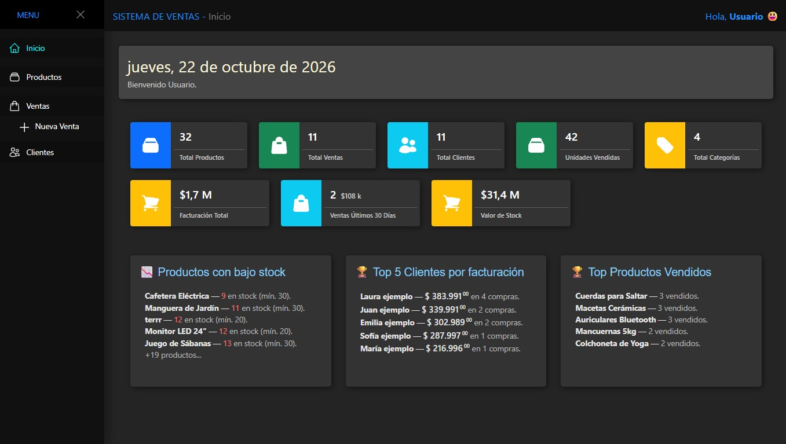
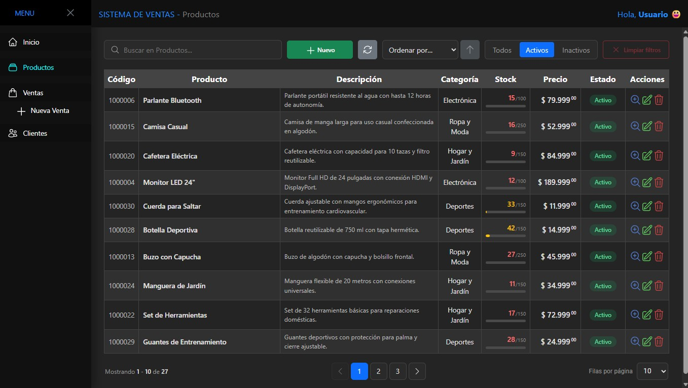
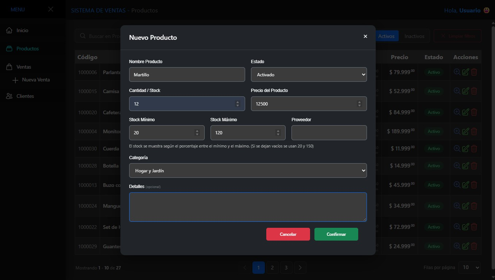
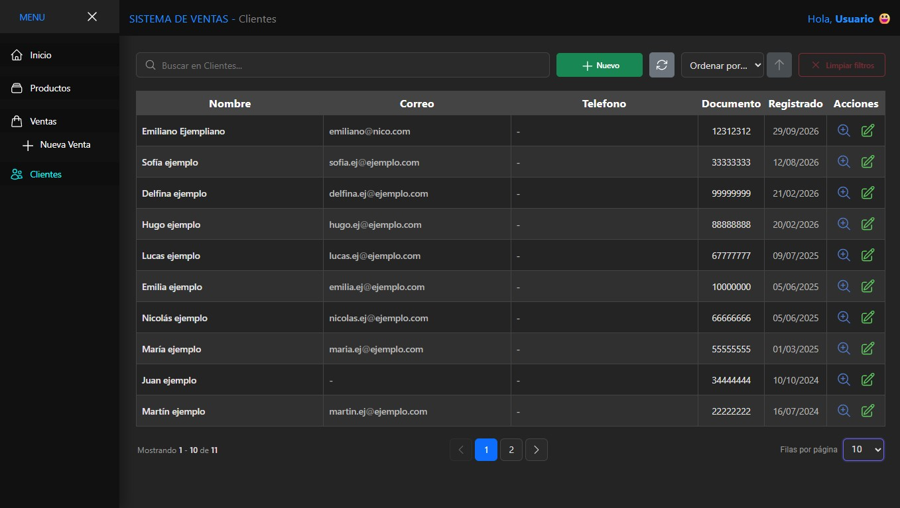
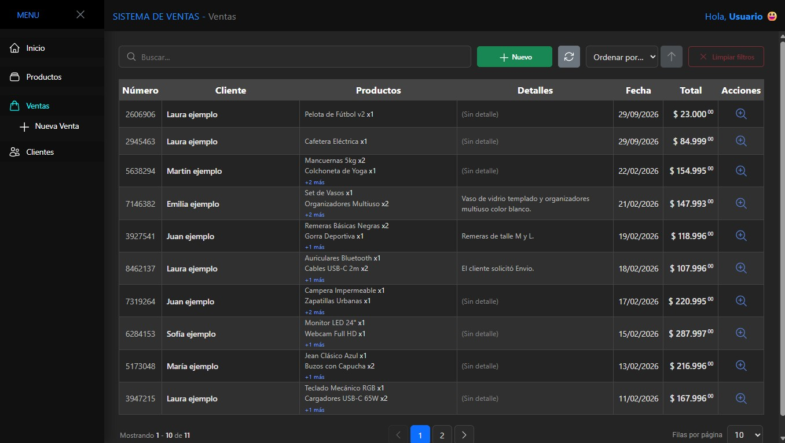
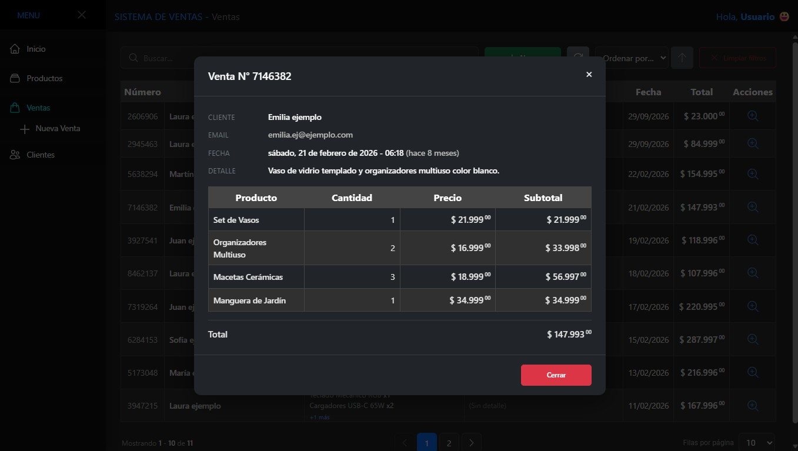
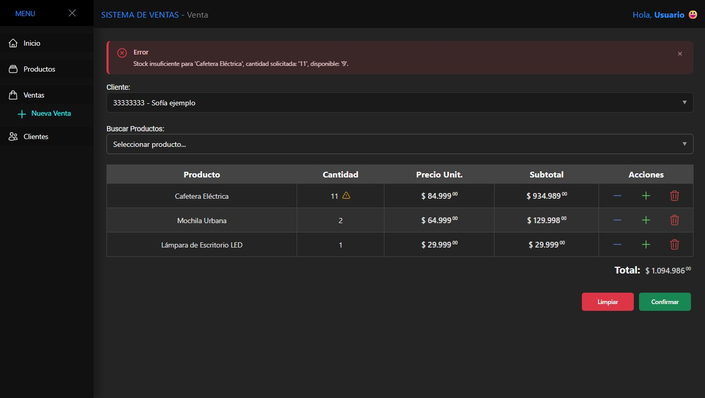

# 📌 Sistema de Ventas

Frontend de un sistema de ventas para gestionar productos, clientes y ventas desde una interfaz simple y funcional. Incluye dashboard con métricas, búsqueda, filtros, ordenamiento y paginación, y consume una API REST de .NET.

**Demo:** [https://sistema-ventas.nicopasino.space](https://sistema-ventas.nicopasino.space)

**Repo Backend API:** [https://github.com/NicoPasino/Sistema-Ventas-API](https://github.com/NicoPasino/Sistema-Ventas-API)


---

## 🚀 Funcionalidades

### Dashboard (Inicio)
- Bienvenida con la fecha actual y el nombre del usuario.
- Tarjetas de resumen: total de productos, ventas, clientes, categorías, unidades vendidas, facturación total, ventas de los últimos 30 días y valor del stock.
- Productos con bajo stock, top 5 de clientes por facturación y productos más vendidos.

### Productos
- CRUD completo con alta, edición, detalle y eliminación.
- Activación/desactivación lógica de productos (por defecto se listan solo los activos).
- Búsqueda local, filtro por estado (activos/inactivos/todos) y filtro por categoría.
- Ordenamiento por cualquiera de las columnas y paginación configurable.
- Validación de datos y control de stock.

### Clientes
- CRUD completo con alta, edición, detalle y eliminación.
- Búsqueda local, ordenamiento por columna y paginación.
- Vista de detalle con estadísticas de compras del cliente.

### Ventas
- Historial de ventas con búsqueda, ordenamiento y paginación.
- Registro de nuevas ventas con carrito: selección de cliente, búsqueda de productos, control de cantidades y cálculo de subtotales y total.
- Validación de stock en tiempo real (incluye lo ya agregado al carrito) antes de confirmar.
- Detalle de venta con productos, cantidades y totales.

### Transversal
- Notificaciones y alertas para el resultado de las operaciones (éxito, error, advertencia).
- Estados de carga, listas vacías y mensajes de error en todas las vistas.
- Diseño responsive con sidebar y header.
- Persistencia de la pestaña activa, el nombre de usuario y el tamaño de página en `localStorage`.

---

## 🛠️ Tecnologías

### Frontend
- **React 19** + **Vite 6** (plugin SWC)
- **JavaScript** (sin TypeScript)
- **Tailwind CSS v4** (vía `@tailwindcss/vite`) + CSS propio
- **pnpm** como gestor de paquetes
- **ESLint** (flat config)

### Backend (repositorio aparte)
- **.NET / C#**
- **MySQL** + **Entity Framework**
- API REST

---

## ⚙️ Instalación y ejecución

### Requisitos
- Node.js 18+
- pnpm
- Una instancia de la [API](https://github.com/NicoPasino/Sistema-Ventas-API) en ejecución

### Pasos

```bash
# 1. Clonar el repositorio
git clone https://github.com/NicoPasino/sistema-ventas.git
cd sistema-ventas

# 2. Instalar dependencias
pnpm install

# 3. Configurar variables de entorno
cp .env.example .env.local

# 4. Ejecutar en desarrollo
pnpm dev
```

Editá `.env.local` con la URL base de la API:

```env
VITE_API_URL=https://localhost:7267/api/ventas
```

> Solo las variables con prefijo `VITE_` se exponen al cliente. Los archivos `.env` y `.env.local` están gitignoreados.

### Scripts disponibles

| Comando | Descripción |
| --- | --- |
| `pnpm dev` | Inicia el servidor de desarrollo con HMR |
| `pnpm build` | Genera el build de producción en `dist/` |
| `pnpm preview` | Previsualiza el build de producción |
| `pnpm lint` | Ejecuta ESLint sobre el proyecto |

---

## 📁 Estructura principal del proyecto

```text
sistema-ventas/
├── public/
│   ├── capturas/                 # Capturas usadas en el README
│   └── favicon.png
└── src/
    ├── components/
    │   ├── layout/               # Header y Sidebar
    │   ├── notification/         # Alert y Popup
    │   ├── pages/                # Tablas, paginación, tarjetas, buscador
    │   └── shared/               # Botones y modal reutilizables
    ├── context/
    │   ├── dataContext.jsx       # Estado global: productos, clientes, ventas
    │   ├── notificationContext.jsx
    │   └── userSettingsContext.jsx
    ├── Hooks/
    │   ├── useItems.js           # Datos + CRUD, filtros, búsqueda y orden
    │   ├── usePaginacion.js      # Paginación client-side
    │   └── userSettings.js       # Pestaña activa y usuario
    ├── layouts/
    │   └── MainLayout.jsx        # Sidebar + Header + contenido
    ├── pages/
    │   ├── Inicio/               # Dashboard y tarjetas de resumen
    │   ├── Productos/
    │   ├── Clientes/
    │   └── Ventas/
    ├── services/
    │   └── api.js                # Capa de acceso a la API (CRUD)
    ├── utils/                    # Fechas, moneda, stock, estadísticas, ventas
    ├── validations/              # Validación de productos y clientes
    ├── App.jsx                   # Resolución de la vista según pestaña activa
    ├── index.css                 # Tailwind + clases globales
    └── main.jsx                  # Punto de entrada
```

---

## 🧱 Arquitectura

### Acceso a datos
Todas las llamadas a la API pasan por `src/services/api.js`, que expone `buildCollection(name)` con las operaciones:

```js
{ obtenerTodos, buscarPorCampo, obtenerPorId, agregar, eliminar, actualizar, cambiarActivo }
```

Las respuestas se normalizan a `{ ok, data }` o `{ ok, error, status }`, y se procesan con `CheckRes` (`src/utils/checkRes.js`) para mostrar notificaciones de forma consistente.

### Estado global
`DataProvider` (`src/context/dataContext.jsx`) expone `{ productos, clientes, ventas }`. Cada colección proviene de `useItems`, que centraliza:

- Carga de datos y manejo de `loading` / `error`.
- CRUD (`agregar`, `actualizar`, `eliminar`, `cambiarActivo`).
- Filtros locales por búsqueda y estado, ordenamiento y recarga.
- Conversión de fechas de UTC a hora local.

### Navegación
No se usa react-router. `App.jsx` resuelve la vista a partir de la pestaña activa (`getTab`) contra un mapa de componentes. La pestaña y el usuario se persisten en `localStorage`.

### Tablas y paginación
Las vistas de listado usan `TablaPaginada`, que combina `TablaGenerica` + `Paginacion`. La paginación es 100 % client-side: recibe la lista filtrada completa y corta en tiempo de render. El tamaño de página (10/25/50/100, por defecto 25) se guarda en `localStorage` bajo `paginaSize_<clave>`.

### UI
Componentes reutilizables separados por área. Tailwind v4 se configura únicamente desde Vite (sin `tailwind.config.js` ni PostCSS), con clases globales en `src/index.css`.

---

## 🖼️ Capturas de pantalla

### Dashboard



### Productos



### Nuevo producto



### Clientes



### Ventas



### Detalle de venta



### Validación de stock en nueva venta



---

## 🗺️ Roadmap

- Gestión de cuentas y autenticación.
- Dashboard con gráficos interactivos.
- Base de datos local para modo offline (IndexedDB).
- Modal propio para confirmaciones (reemplazo de `confirm()`).

---

## 🧑‍💻 Autor

**Nicolás Pasino** — nico_pasino@hotmail.com

[](https://www.linkedin.com/in/nicolas-pasino/)
[](https://nicopasino.space)
